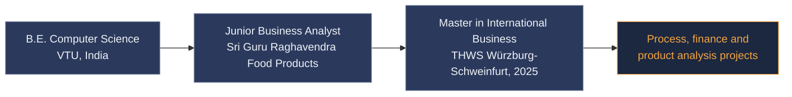
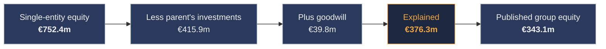
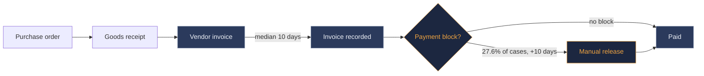

  

  
  
  
  

 

## About

Most companies already know their processes are slow. What they usually don't know is **where** the time goes and **which fix pays off first**. That's the work I like: mapping a process step by step, checking it against the data, and turning it into a short list of changes with a number attached.

I studied Computer Science in India, worked as a junior business analyst, and then did a Master in International Business at THWS in Würzburg. So I'm at home on both sides: talking to the people who run a process, and working with the data behind it.

| | |
|---|---|
| **Focus** | Process analysis, finance and reporting, product analytics |
| **Location** | Würzburg, Germany |
| **Languages** | English, Telugu, German (intermediate) |

 

## Background

 

## Tools and methods

| Area | Used in my projects |
|---|---|
| **Analysis** | Python, pandas, Jupyter |
| **Data** | SQL: DuckDB, SQLite, Google BigQuery |
| **Reporting** | Excel, Power BI, matplotlib |
| **Finance** | Group consolidation, currency translation (IAS 21), SAP S/4HANA Group Reporting concepts |
| **Process** | Process mapping, process mining, KPI design, business cases |
| **Product** | Review and funnel analysis, RICE prioritisation, PRD writing |
| **Engineering** | Git, automated tests (pytest), HTML/CSS/JS, Claude API |

 

## Recent projects

### 01 &nbsp;·&nbsp; Group consolidation with real data: Koenig & Bauer

**[group-consolidation-koenig-bauer](https://github.com/ramya-rajendra/group-consolidation-koenig-bauer)** &nbsp;|&nbsp; Excel, Python, ECB exchange rates, SAP Group Reporting mapping

How do the accounts of 40 separate companies turn into one set of group figures? I rebuilt the main consolidation steps of Koenig & Bauer from its public 2025 annual report, including currency translation, and documented the part public data can't explain instead of forcing it to zero.

| Finding | |
|---|---|
| Consolidation units | **40**, in 13 currencies |
| Remaining gap, documented | **–€33.2m**, mainly holdings between subsidiaries |
| US subsidiary growth | **+33%** in USD, only **+18%** in EUR |

 

### 02 &nbsp;·&nbsp; Zalando app reviews: what users want fixed first

**[zalando-app-review-analysis](https://github.com/ramya-rajendra/zalando-app-review-analysis)** &nbsp;|&nbsp; Python, BigQuery SQL, Power BI, Claude

I tagged 3,000 German Play Store reviews by theme and sentiment, checked them against checkout funnel data, and prioritised the fixes with RICE. The top priority became a PRD and a [clickable prototype](https://ramya-rajendra.github.io/zalando-app-review-analysis/docs/checkout-prototype/). Personal project, not affiliated with Zalando.

| Finding | |
|---|---|
| Reviews analysed | **3,000** |
| Checkout starts not completed | **about 55%** |
| Top priority after RICE | **A more reliable checkout** |

 

### 03 &nbsp;·&nbsp; Purchase-to-pay on real company data

**[p2p-real-data-analysis](https://github.com/ramya-rajendra/p2p-real-data-analysis)** &nbsp;|&nbsp; Python, pandas, SQL (DuckDB)

I analysed the BPI Challenge 2019 event log: **1.6 million process steps** from the purchase-to-pay process of a large multinational paint and coatings company. Payment blocks were the biggest delay, and most of them are still released by hand.

| Finding | |
|---|---|
| Median time from vendor invoice to payment | **64 days** |
| Payment block releases done by hand | **73%** |
| Share of paid cases from the 10 largest vendors | **31%** |

<b>What I'd recommend first</b>

 

1. Get the payment terms per vendor and check how much early-payment discount is being lost
2. Automate payment block releases when goods receipt and invoice already match, starting with the largest vendors
3. Talk to the three vendors with the highest block rates. One of them alone has over 10,000 cases, a block on more than half, and a median of 112 days to payment
4. Track invoice-to-record time as a KPI, since every day lost there comes out of the payment window

 

## More of my work

| | |
|---|---|
| **[Invoice processing](https://github.com/ramya-rajendra/invoice_automation)** | Process analysis and automation prototype: lost early-payment discount worth about €247k EBIT per year |
| **[Master's thesis](https://opus4.kobv.de/opus4-fhws/frontdoor/index/index/docId/6594)** &nbsp;([PDF](https://opus4.kobv.de/opus4-fhws/frontdoor/deliver/index/docId/6594/file/Masterarbeit_Rajendra.pdf)) | How AI-driven methods could help value a brand when one company buys another |
| **[Portfolio website](https://ramya-rajendra.github.io/ramya-portfolio/)** &nbsp;([code](https://github.com/ramya-rajendra/ramya-portfolio)) | My work in one place, built with HTML and CSS |
| **[All repositories](https://github.com/ramya-rajendra?tab=repositories)** | Every project, including smaller and earlier work |

 

---

  Looking for business, process and finance analyst roles anywhere in Germany. 
  If you work in this field, or have a process everyone complains about but nobody has measured, <a href="mailto:ramyareddy9488@gmail.com">I'd like to hear from you</a>.  
  

