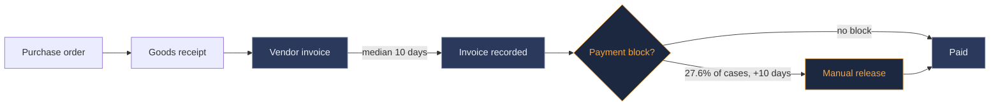

  

  
  
  
  

 

Most companies already know their processes are slow. What they usually don't know is **where** the time goes and **which fix pays off first**. That's the work I like: mapping a process step by step, checking it against the data, and turning it into a short list of changes with a number attached.

I studied Computer Science in India, worked as a marketing analyst, and then did an MBA in International Business at THWS in Würzburg. So I'm at home on both sides: talking to the people who run a process, and working with the data behind it.

 

## Case study 1 &nbsp;·&nbsp; Invoice processing: from process analysis to EBIT impact

**[invoice_automation](https://github.com/ramya-rajendra/invoice_automation)** &nbsp;|&nbsp; Python, pandas, SQL (SQLite), process mapping, Claude API prototype

A mid-sized German manufacturer handles about 12,000 supplier invoices a year, mostly by hand. I mapped the as-is process, analysed a year of invoice data, designed a to-be process and built a small prototype. The company and data are fictional, so the numbers show the method.

<table>
<tr>
<td width="55%"></td>
<td width="45%">

| | As-is | To-be |
|---|---|---|
| Cycle time | 9.0 days | **4.6 days** |
| Discount paid in time | 67% | **95%** |
| Skonto lost / year | €239k | **€51k** |
| Cost per invoice | €15.06 | **€10.12** |

**Estimated EBIT effect: about €247k per year.** Even with conservative assumptions it stays around €186k.

</td>
</tr>
</table>

The surprising part: the biggest cost wasn't clerk time, it was lost early-payment discount. And almost half of it came from invoices that matched perfectly but simply waited, first in the entry backlog and then for the weekly payment run.

 

## Case study 2 &nbsp;·&nbsp; Purchase-to-pay on real company data

**[p2p-real-data-analysis](https://github.com/ramya-rajendra/p2p-real-data-analysis)** &nbsp;|&nbsp; Python, pandas, SQL (DuckDB)

To test the same questions on real data, I analysed the BPI Challenge 2019 event log: **1.6 million process steps** from the purchase-to-pay process of a large multinational paint and coatings company.

<table>
<tr>
<td width="50%"></td>
<td width="50%"></td>
</tr>
</table>

| Finding | |
|---|---|
| Median time from vendor invoice to payment | **64 days** |
| Paid cases with a payment block | **27.6%**, +10 days |
| Extra time when an invoice is cancelled | **+28 days** |
| Share of paid cases from the 10 largest vendors | **31%** |
| Payment block releases done by hand | **73%** |

<b>What I'd recommend first</b>

 

1. Get the payment terms per vendor and check how much early-payment discount is being lost
2. Automate payment block releases when goods receipt and invoice already match, starting with the largest vendors
3. Talk to the three vendors with the highest block rates. One of them alone has over 10,000 cases, a block on more than half, and a median of 112 days to payment
4. Track invoice-to-record time as a KPI, since every day lost there comes out of the payment window

 

## More of my work

| | |
|---|---|
| **[MBA thesis](https://opus4.kobv.de/opus4-fhws/frontdoor/index/index/docId/6594)** &nbsp;([PDF](https://opus4.kobv.de/opus4-fhws/frontdoor/deliver/index/docId/6594/file/Masterarbeit_Rajendra.pdf)) | How AI-driven methods could help value a brand when one company buys another |
| **[Portfolio website](https://ramya-rajendra.github.io/ramya-portfolio/)** &nbsp;([code](https://github.com/ramya-rajendra/ramya-portfolio)) | My work in one place, built with HTML and CSS |

 

## Background

| | |
|---|---|
| **MBA, International Business** | THWS Würzburg-Schweinfurt, 2025 |
| **B.E., Computer Science** | India |
| **Marketing analyst** | Sri Guru Raghavendra Food Products, India |
| **Hackathon** | Prize winner at a GitHub hackathon |
| **Languages** | Telugu, English, German (intermediate) |

  
  
  
  
  
  
  

 

---

  Looking for business, process and product analyst roles anywhere in Germany. 
  If you have a process everyone complains about but nobody has measured, <a href="mailto:ramyareddy9488@gmail.com">I'd like to hear about it</a>.

