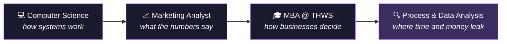

<p align="center">
  
</p>

<p align="center">
  <a href="https://git.io/typing-svg">
    
  </a>
</p>

<p align="center">
  <a href="https://www.linkedin.com/in/ramyarajendra/"></a>
  <a href="mailto:ramyareddy9488@gmail.com"></a>
  <a href="https://github.com/ramya-rajendra/ramya-portfolio"></a>
  
</p>

<p align="center">
  
  
  
</p>

---

### `> whoami`

```sql
SELECT name, base, education, started_as, speaks, looking_for
FROM   people
WHERE  github = 'ramya-rajendra';
```

| name | base | education | started_as | speaks | looking_for |
|---|---|---|---|---|---|
| Ramya Rajendra | Würzburg 🇩🇪 | B.E. CS (India) · MBA Int. Business, THWS (2025) | Marketing analyst, India | Telugu, English, Deutsch (in progress) | Business / Product / Marketing Analyst |

```text
(1 row)
```

---

### 🧭 The long way round



The part I enjoy most is the translation work: sitting with the people who run a process, understanding what actually goes wrong, and turning it into something a developer or a manager can act on.

---

### 🚀 Featured project: purchase-to-pay on real data

<a href="https://github.com/ramya-rajendra/p2p-real-data-analysis">
  
</a>

1.6 million process steps from a large multinational's BPI Challenge 2019 event log. What came out:

| | |
|---|---|
| ⏱️ **64 days** | median time from vendor invoice to payment |
| 📥 **10 days** | before an invoice is even recorded in the system |
| 🚧 **27.6%** | of paid cases hit a payment block (+10 days) |
| ❌ **+28 days** | extra when an invoice gets cancelled |
| 🏢 **31%** | of all paid cases come from just 10 vendors |
| 🤖 **73%** | of payment block releases still done by hand |

<details>
<summary><b>What I'd recommend to the company</b></summary>
<br>

1. Get the payment terms per vendor and check how much early-payment discount is being lost
2. Automate payment block releases when goods receipt and invoice match, starting with the top vendors
3. Talk to the three vendors with the highest block rates about the root cause
4. Track invoice-to-record time as a KPI

</details>

---

### 🗂️ More things I built

<p>
  <a href="https://github.com/ramya-rajendra/invoice_automation">
    
  </a>
  <a href="https://github.com/ramya-rajendra/ramya-portfolio">
    
  </a>
</p>

<details>
<summary><b>🎓 MBA thesis: AI and brand value in M&A</b></summary>
<br>

How AI-driven methods could help put a number on a brand when one company buys another. Brands are hard to value, which is exactly why it was interesting.

📄 [Read the thesis (PDF)](https://opus4.kobv.de/opus4-fhws/frontdoor/deliver/index/docId/6594/file/Masterarbeit_Rajendra.pdf)

</details>

<details>
<summary><b>🏆 GitHub hackathon</b></summary>
<br>

Won a prize at a GitHub hackathon, back in my Computer Science days.

</details>

---

### 🧰 Toolbox

<p align="center">
  
</p>
<p align="center">
  
  
  
  
  
</p>

---

### 📊 GitHub activity

<p align="center">
  
  
</p>
<p align="center">
  
</p>

---

<p align="center">
  <b>Have a process that everyone complains about but nobody has written down?</b><br/>
  That's the kind of problem I like. <a href="mailto:ramyareddy9488@gmail.com">Say hello</a> 👋
</p>

<p align="center">
  
</p>
